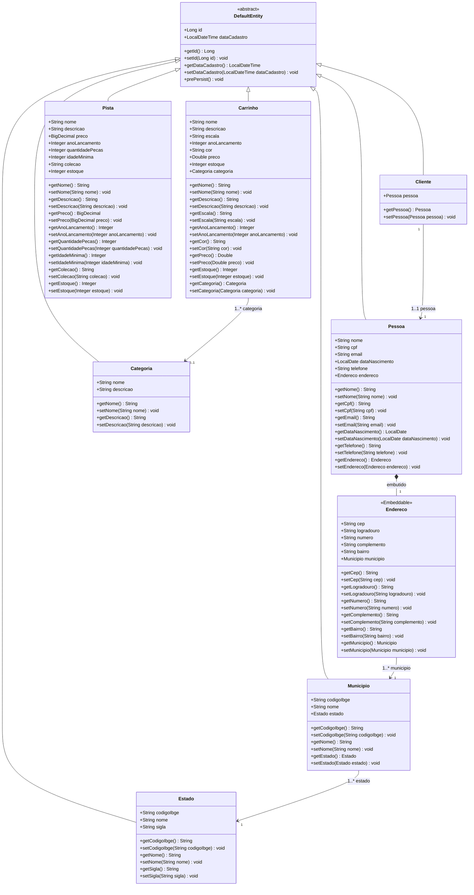
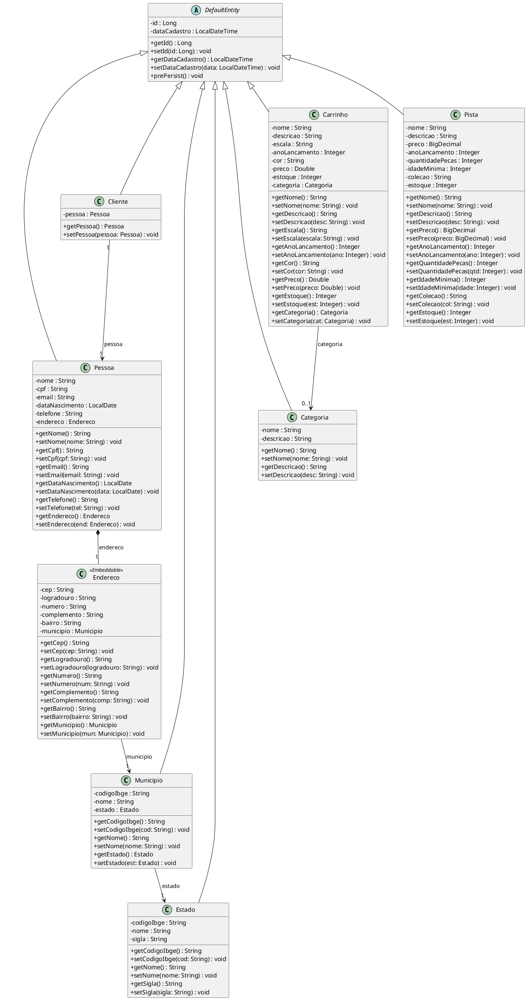

# Diagramas UML - ColdWheels Backend

Este documento reúne os diagramas UML da aplicação **ColdWheels Backend** desenvolvida em Quarkus.

---

## 1. Diagrama de Classes do Domínio (Modelo de Dados)

### Formato Mermaid

---

### Formato PlantUML

